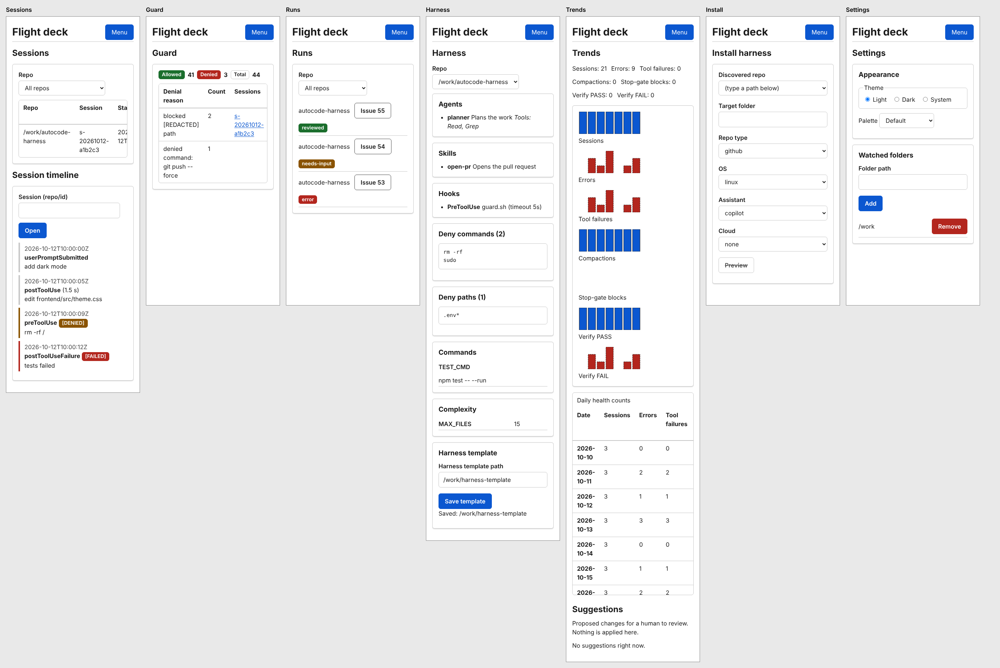
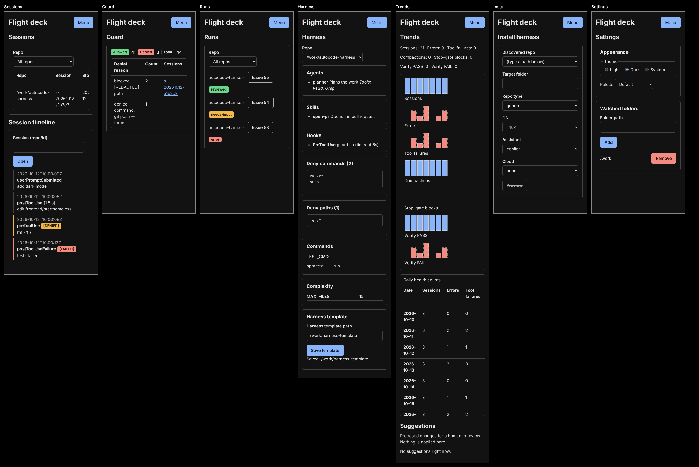

# Theming

Flight deck's look is a set of CSS custom properties (design tokens). A theme is just a set of values for them,
so pages never hard-code a colour.

## Where things live

| File                      | What it does                                                                                                                      |
| ------------------------- | --------------------------------------------------------------------------------------------------------------------------------- |
| `frontend/src/theme.css`  | The tokens, the light and dark palettes, and the named palettes (token overrides only). The only place colour values are allowed. |
| `frontend/src/styles.css` | Base styles for headings, links, focus rings, buttons, inputs, tables, `code`, plus `prefers-reduced-motion`.                     |
| `frontend/src/ui/`        | Shared components (`Card`, `Badge`, `Button`, `Field`, `TableWrap`, ...) and `ui.css`. Tokens only.                               |
| `frontend/src/theme.ts`   | Reads and stores the user's choice and applies it to `<html>`.                                                                    |
| `frontend/index.html`     | A small inline script that applies the stored choice before first paint, so there is no flash.                                    |

## Tokens

Colour: `--color-surface`, `--color-text`, `--color-text-muted`, `--color-border`, `--color-accent`, `--color-on-accent`,
and `--color-success`, `--color-warning`, `--color-danger` each with an `--color-on-*` text colour for use on top.
Shared: `--space-1` to `--space-6`, `--radius`, `--font-sans`, `--shadow`.

Use tokens in stylesheets (`color: var(--color-text)`); never write `#rrggbb` or `rgb()` outside `theme.css`.
A test (`a11y.test.ts`) fails if you do, or if you use a token `theme.css` does not define.

## How the choice is applied

- **Mode** (Light, Dark, System) sets `data-theme="light|dark"` on `<html>`. System follows `prefers-color-scheme`
  and updates live when the OS setting changes.
- **Palette** sets `data-palette="<id>"` on `<html>`. The Default palette has no attribute.
- Both are stored in `localStorage` (`flightdeck-theme` is `light` or `dark`, absent for System; `flightdeck-palette`
  is the palette id, absent for Default). Missing, unknown or unreadable values fall back to System and Default.
- Settings, Appearance is the user-facing picker.

## Add a palette

1. Add `{ id: "my-palette", label: "My palette" }` to `PALETTES` in `frontend/src/theme.ts`.
2. In `theme.css` add two blocks, one per mode, overriding colour tokens only:

   ```css
   :root[data-palette="my-palette"][data-theme="light"] {
     --color-surface: #...; /* all 12 colour tokens */
   }
   :root[data-palette="my-palette"][data-theme="dark"] {
     --color-surface: #...; /* all 12 colour tokens */
   }
   ```

3. Run `bash scripts/factory/check.sh`. `palettes.test.ts` walks the registry and fails unless both blocks exist,
   define every colour token, override nothing else, and meet WCAG AA (4.5:1) for text on surface, muted text on
   surface, accent on surface, and each `--color-on-*` on its colour.

Nothing else needs to change: the picker lists whatever is in `PALETTES`.

## Accessibility rules the tests enforce

- Text and accent colours meet 4.5:1 against their background in every palette and mode.
- Focus is always visible (`:focus-visible` outline, 2px accent). Only the skip-link target (`.shell-main:focus`) hides it.
- No positive `tabindex`; clicks are attached only to real controls (buttons and links), so everything is keyboard reachable.
- `prefers-reduced-motion: reduce` disables transitions, animations and smooth scrolling.
- State is never colour alone: badges carry text, links are underlined, failure series in charts are dashed and labelled.

## What it looks like

Every page at 360px wide (the narrowest supported width, no horizontal page scroll):




